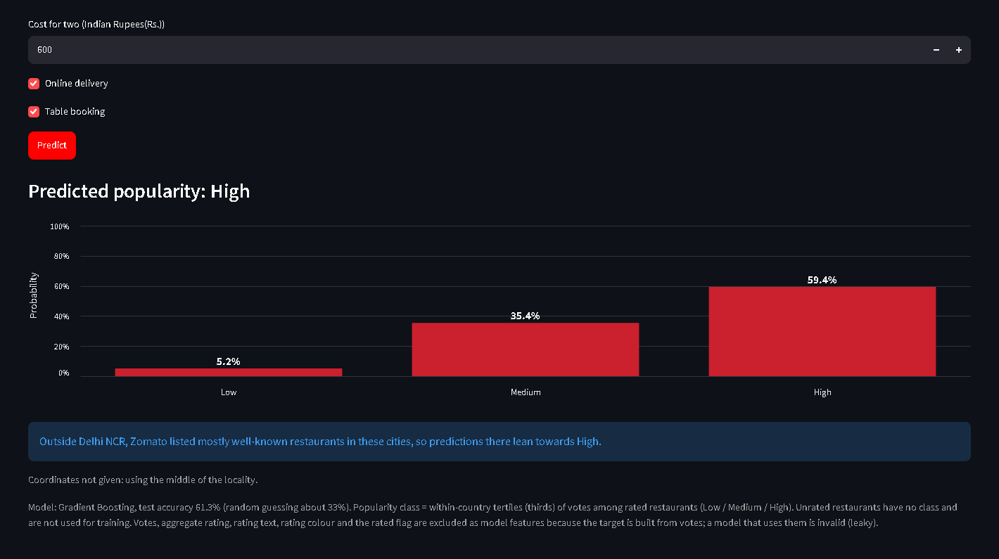

# Restaurant Intelligence System

**Restaurant recommendation and popularity prediction using data analytics.**

[Open the live Streamlit app](https://restaurant-intelligence-system-mpzgeltz7a2glsjmyprrff.streamlit.app/)

This project analyses the public Zomato restaurant dataset from Kaggle: 9,551 restaurants across 15 countries and 141 cities. It includes a recommendation engine, a popularity prediction model, data-quality and exploratory analysis, SQL queries, Excel reports, Power BI and Tableau dashboards, and a browser-based what-if app.

## Features

- Recommend restaurants by city, cuisine, budget, rating, and delivery availability, with a score breakdown.
- Predict Low, Medium, or High popularity for a restaurant using the saved model.
- Clean and validate source data, generate analysis outputs, and optionally load data into MySQL.
- Explore six Power BI pages, five Tableau dashboards, and the Streamlit app.

## Quick start

Python 3.12 or 3.13 is recommended. On macOS, run the included setup script once:

```bash
bash scripts/setup_mac.sh
source .venv/bin/activate
```

On Windows, create and activate a virtual environment, then install the dependencies:

```powershell
python -m venv .venv
.venv\Scripts\Activate.ps1
pip install -r requirements.txt
```

Run the analysis pipeline without MySQL, or start the interactive app:

```bash
python run_pipeline.py --no-mysql
streamlit run scripts/app.py
```

The Streamlit app offers **Predict** and **Recommend** tabs. MySQL is optional; use `python run_pipeline.py` if you have configured the database.

## App screenshots

### Predict




### Recommend


## Dashboards

- **Tableau:** Open `dashboards/tableau/RestaurantIntelligence.twbx` in Tableau Public; the packaged workbook includes its data extracts.
- **Power BI:** Open `dashboards/powerbi/RestaurantIntelligence.pbix` in Power BI Desktop on Windows. On macOS, view the exported pages in `dashboards/powerbi/exports/RestaurantIntelligence.pdf` or the PNGs.

## Tests

Run the test suite locally:

```bash
python -m pytest -q
```


GitHub Actions runs the test suite automatically on pushes and pull requests.

## Project layout

| Path | Contents |
|---|---|
| `run_pipeline.py` | End-to-end data analysis pipeline |
| `src/` | Data loading, cleaning, analysis, modeling, and recommendation code |
| `scripts/` | Streamlit app, command-line tools, and setup helpers |
| `data/` | Raw, processed, and sample datasets |
| `sql/` | Database schema, views, and analytical queries |
| `models/`, `outputs/` | Saved model and generated results |
| `dashboards/` | Power BI and Tableau files and exports |
| `report/`, `docs/` | Reports and project documentation |
| `tests/` | Automated tests |

## Configuration and data

`.env.example` is a template for optional MySQL settings. Copy it to `.env` and enter your local settings if needed. **Do not commit `.env` or put passwords, API keys, or other secrets in the repository.**

The project analyzes public Kaggle data; check the dataset's source and license before reusing or redistributing the data.
