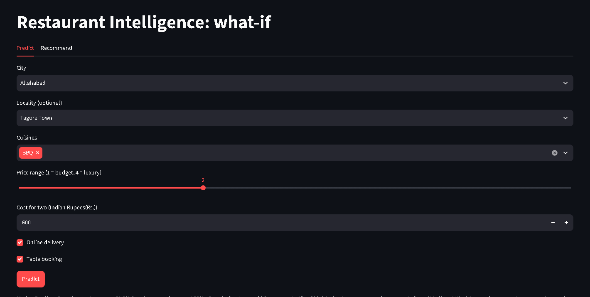
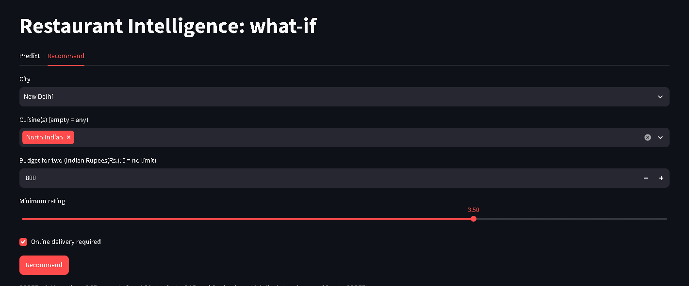
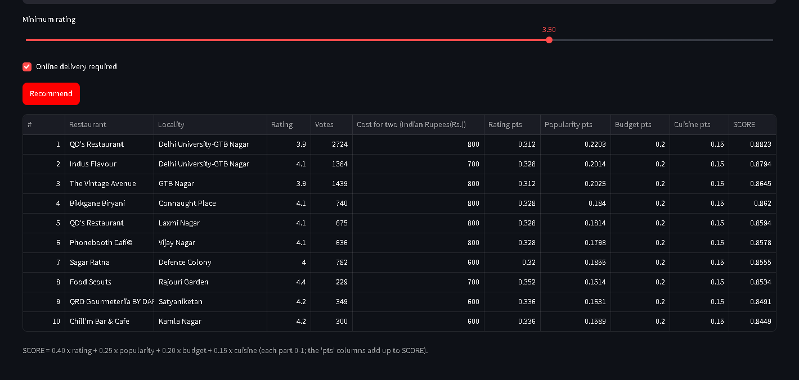
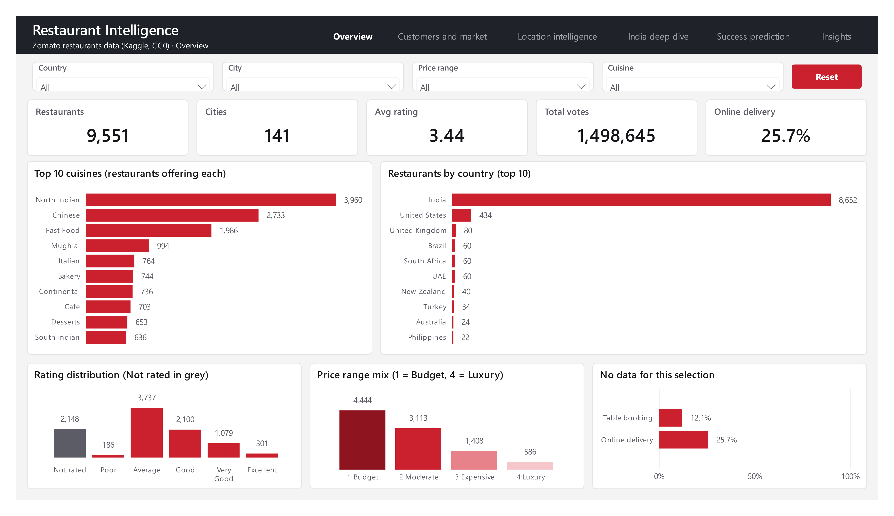
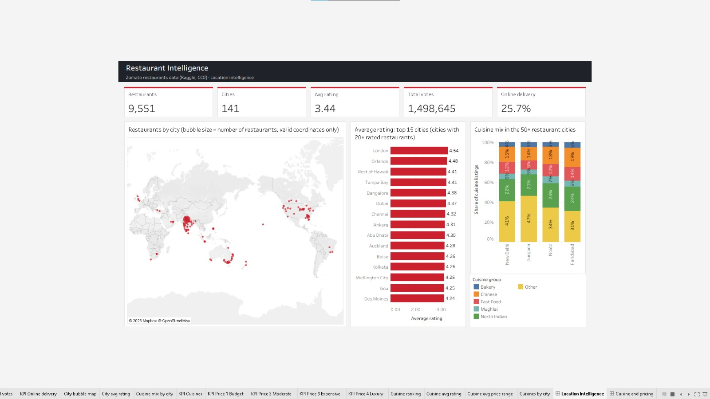
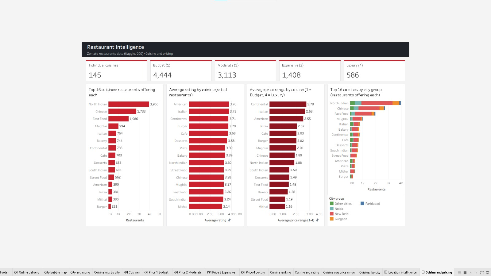

# Restaurant Intelligence System

**Restaurant recommendation and popularity prediction using data analytics.**

[Open the live Streamlit app](https://mohd-ahad-restaurant-intelligence-system.streamlit.app/)

This project analyses public Zomato data from Kaggle: 9,551 restaurant records across 15 countries and 141 cities. It brings together data preparation, exploratory analysis, SQL, predictive modeling, restaurant recommendations, interactive dashboards, and a live Streamlit app.

## Project highlights

| Measure | Result |
|---|---:|
| Restaurant records analyzed | 9,551 |
| Countries and cities | 15 countries · 141 cities |
| Rated records used for modeling | 7,403 |
| Best classifier | Gradient Boosting |
| Test accuracy | 61.3% (33.6% majority-class baseline) |
| Test macro-F1 / ROC-AUC | 0.611 / 0.795 |
| Analytical SQL queries | 28 |

The popularity target is based on vote tertiles among rated restaurants. Votes and rating fields are excluded from model inputs to prevent target leakage. Results are observational and reflect the dataset's uneven geographic coverage; see the [model results and limitations](docs/model_results.md).

## Features

- Recommend restaurants by city, cuisine, budget, rating, and delivery availability, with a score breakdown.
- Predict Low, Medium, or High popularity for a restaurant using the saved model.
- Clean and validate source data, generate analysis outputs, and optionally load data into MySQL.
- Explore six Power BI pages, five Tableau dashboards, and the Streamlit app.

## Quick start

Python 3.12 or 3.13 is recommended. On macOS, run the included setup script once:

```bash
bash scripts/setup_mac.sh
source .venv/bin/activate
```

On Windows, create and activate a virtual environment, then install the dependencies:

```powershell
python -m venv .venv
.venv\Scripts\Activate.ps1
pip install -r requirements.txt
```

Run the analysis pipeline without MySQL, or start the interactive app:

```bash
python run_pipeline.py --no-mysql
streamlit run scripts/app.py
```

The Streamlit app offers **Predict** and **Recommend** tabs. MySQL is optional; use `python run_pipeline.py` if you have configured the database.

## Reports and analysis

- [Full project report (PDF)](report/Project_Report_Full.pdf)
- [Project report (PDF)](report/Project_Report.pdf)
- [Model results and evaluation](docs/model_results.md)
- [Key data insights](docs/insights.md)
- [India market analysis](docs/india_deep_dive.md)
- [How to run the project](docs/HOW_TO_RUN.md) · [Mac setup](docs/MAC_SETUP.md)

## App screenshots

### Predict




### Recommend





## Dashboard gallery

### Power BI

Six interactive report pages covering the restaurant overview, customers and market, location intelligence, India deep dive, popularity prediction, and insights.

[Open the Power BI PDF export](dashboards/powerbi/exports/RestaurantIntelligence.pdf) · [Power BI Desktop file](dashboards/powerbi/RestaurantIntelligence.pbix)

[](dashboards/powerbi/exports/RestaurantIntelligence.pdf)

More pages: [Customers & market](dashboards/powerbi/exports/page2_customers_market.png) · [Location](dashboards/powerbi/exports/page3_location.png) · [India](dashboards/powerbi/exports/page4_india.png) · [Prediction](dashboards/powerbi/exports/page5_prediction.png) · [Insights](dashboards/powerbi/exports/page6_insights.png)

### Tableau

Five dashboards with packaged data extracts. Open the `.twbx` workbook in Tableau Public.

[Download Tableau workbook](dashboards/tableau/RestaurantIntelligence.twbx)

[](dashboards/tableau/RestaurantIntelligence.twbx)

[](dashboards/tableau/RestaurantIntelligence.twbx)

### Excel

The Excel workbook includes the raw sample, data dictionary, quality checks, cleaning log, cleaned data, cuisine pairs, formula-driven summaries, and charts.

[Download the Excel analysis workbook](excel/zomato_phase1_analysis.xlsx)

Power BI Desktop is available for Windows; on macOS, use the PDF and PNG exports. Tableau packaged workbooks open in Tableau Public.

## Tests

Run the test suite locally:

```bash
python -m pytest -q
```


Run tests locally with `python -m pytest -q`. The project includes optional MySQL- and Tableau-dependent checks; these may be skipped when the corresponding software or service is unavailable.

## Project layout

| Path | Contents |
|---|---|
| `run_pipeline.py` | End-to-end data analysis pipeline |
| `src/` | Data loading, cleaning, analysis, modeling, and recommendation code |
| `scripts/` | Streamlit app, command-line tools, and setup helpers |
| `data/` | Raw, processed, and sample datasets |
| `sql/` | Database schema, views, and analytical queries |
| `models/`, `outputs/` | Saved model and generated results |
| `dashboards/` | Power BI and Tableau files and exports |
| `report/`, `docs/` | Reports and project documentation |
| `tests/` | Automated tests |

## Configuration and data

`.env.example` is a template for optional MySQL settings. Copy it to `.env` and enter your local settings if needed. **Do not commit `.env` or put passwords, API keys, or other secrets in the repository.**

The project analyzes public Kaggle data; check the dataset's source and license before reusing or redistributing the data.
